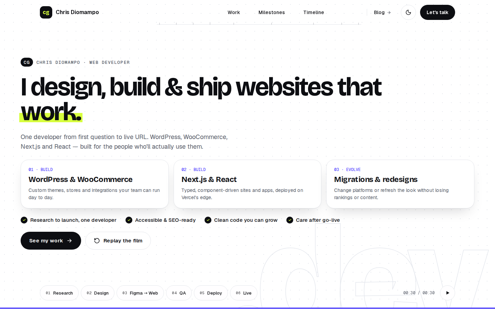

# cgdiomampo.dev

Portfolio and dev blog for Chris Diomampo, a senior full-stack developer working in Next.js and WordPress. It is a Next.js app with a custom admin, and the home page opens on a film built in Remotion.

<p align="center">
  
  &nbsp;
  
</p>

## Features

- **Hero film:** a Remotion composition played in the browser, with separate desktop and mobile cuts, chapter controls and a reduced-motion fallback that opens on the final frame.
- **Public site:** home page sections, project case studies, a blog with RSS, and a contact form.
- **Admin:** GitHub sign-in restricted to an allowlist, with editors for posts, projects, milestones, the timeline, the stack, page copy and settings, plus a contact inbox.
- **Light and dark themes,** stored in a cookie.
- **SEO:** generated metadata and share cards, a sitemap, `llms.txt` and IndexNow pings on publish.

## Stack

| Area | Tools |
| --- | --- |
| Framework | Next.js 16 (App Router, React Server Components), React 19, TypeScript strict |
| Styling | Tailwind CSS v4 with `@theme` tokens, shadcn/ui in the admin only |
| Motion | Remotion 4 and `@remotion/player` |
| Data | PostgreSQL 18, Prisma 7 |
| Auth | Better Auth with GitHub OAuth |
| Services | Cloudflare R2 (uploads), Resend (contact email) |
| Quality | Biome, Vitest, Playwright with axe and visual baselines |
| Hosting | Docker image on Coolify |

## Getting started

Needs Node 24 or newer, pnpm and Docker.

```bash
pnpm install
cp .env.example .env
pnpm db:up       # Postgres in Docker, on port 5437
pnpm db:deploy   # apply the migrations
pnpm db:seed     # insert the starter content
pnpm dev
```

The site runs at <http://localhost:3000>. The public pages only need `DATABASE_URL`, which `.env.example` already points at the Docker database. Each remaining variable is explained in `.env.example`:

- The contact form needs `BETTER_AUTH_SECRET` (at least 32 characters, from `openssl rand -base64 32`).
- `/admin` needs that secret, a GitHub OAuth app (`GITHUB_CLIENT_ID`, `GITHUB_CLIENT_SECRET`) and your GitHub email in `ADMIN_EMAILS`.
- Uploads need the `R2_*` values.
- Without `RESEND_API_KEY`, contact messages still reach the admin inbox and the email is skipped.

## Scripts

| Command | What it does |
| --- | --- |
| `pnpm dev` | Start the dev server |
| `pnpm build` / `pnpm start` | Build and run for production (the build reads the database) |
| `pnpm typecheck` | Generate route types and run `tsc` |
| `pnpm lint` / `pnpm format` | Check, or fix, with Biome |
| `pnpm test` | Unit tests with Vitest |
| `pnpm test:e2e` | Reset the `cgendio_test` database, build, and run Playwright at 1440px and 390px |
| `pnpm db:up` / `pnpm db:down` | Start or stop local Postgres |
| `pnpm db:studio` | Open Prisma Studio |
| `pnpm remotion:studio` | Open the hero film in Remotion Studio |

## Project layout

```text
src/app/                  routes (App Router), including /admin
src/components/site/      header, footer, page chrome
src/components/sections/  one server component per home page section
src/components/ui-site/   the public site's own primitives
src/components/ui/        shadcn/ui, admin only
src/components/hero-film/ the Remotion hero
src/server/               data access and server actions
src/lib/                  shared helpers
prisma/                   schema, migrations, seed
e2e/                      Playwright specs and visual baselines
docs/                     build plan, deployment guide, design references
```

## Docs

- [Deploying to Coolify](docs/DEPLOY.md)
- [Build plan](docs/BUILD_PLAN.md)

## License

The source code is available under the [MIT License](LICENSE). My written content, images, design references and branding are not covered and remain all rights reserved, and the self-hosted fonts keep their own SIL Open Font License. See [NOTICE](NOTICE) for the full scope.
